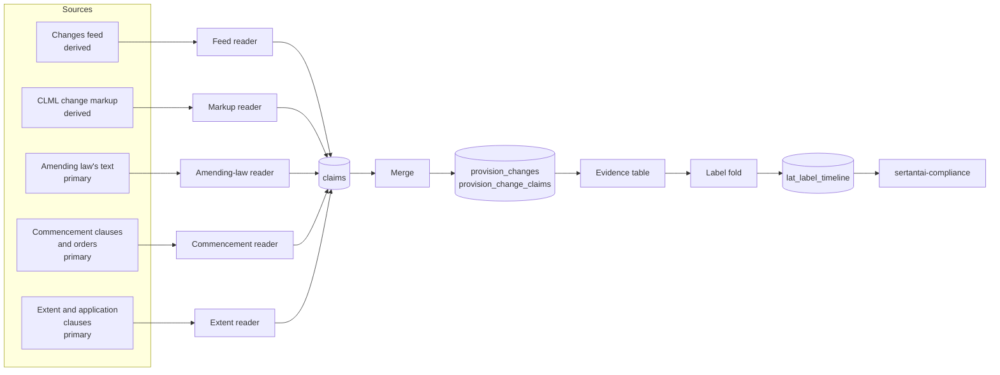

# The LAT Change Pipeline

The LAT Change Pipeline works out, for every provision of a law we hold as LAT (Legal Article Text), four labels over time:

- **status**: in force, partly in force, prospective, repealed, or repealed with a saving;
- **in force from**: when the current text took effect;
- **territory**: where the provision applies (E, W, S, NI and their unions);
- **changed by**: the laws that made the current text, and apart from them the law that brought it into force (`commenced_by`).

The labels are written to `lat_label_timeline`, one row per period. That table is what the compliance product reads to tell a user whether a provision binds them today, since when and where.

This page explains the idea, the 14 steps, and three changes traced from source to label. Words in **bold** on first use are defined in the [Glossary](GLOSSARY.md).

## Why it exists

legislation.gov.uk tells us about a change to a law in three different ways:

1. **The changes feed** (semi-structured). One record per change, an **effect**, with a type ("words substituted", "inserted", "omitted"), the provisions affected, the amending law and provision, and in-force dates.
2. **The CLML change markup** (structured). The revised text of the law marks inserted, substituted and repealed passages (`Addition`, `Substitution`, `Repeal`), each pointing at a note.
3. **The legal text itself** (unstructured). The amending law's own instruction ("in subsection (1) … there is substituted …"), its commencement clause and commencement orders, and its extent and application clauses.

The first two are legislation.gov.uk's editorial work: **derived**. The third is the law: **primary**. The rule is simple: the law's own text wins where it speaks; the derived sources fill what it doesn't say; every disagreement between them is reported, never quietly reconciled. Notes in the markup are **pointers** (they say where to look), never facts.

Before this pipeline, each source was handled by different code, merged twice in different places, and patched with rules that made two sources agree at the edges. Labels came out wrong in ways that were hard to trace. The pipeline replaces that with one shape for every source.

## The idea in plain words

```
sources ──► readers ──► claims ──► merge ──► change record ──► evidence ──► label fold ──► periods ──► lat_label_timeline
```

1. **Readers.** One reader per source. A reader does one job: it turns what its source says into **claims**. A claim is one source's statement about one attribute of one change: "the feed says the operation is `inserted`", "the amending law's commencement says the date is 1998-07-01". A reader never decides between sources.
2. **Merge.** Claims about the same real change, from whichever sources state it, are grouped into one **change record** (a row of `provision_changes`, its claims in `provision_change_claims`). The **merge identity** is the effect id where any source carries one; otherwise the amending law and amending provision, on the same provision or one above or below it.
3. **Evidence.** For each attribute of a change (operation, level, territory, date, by, commenced by, saved, partial, retained), one table in one module (`ChangeVocabulary.Evidence`) says which source wins: the primary text first, then the feed or the markup, under a few named conditions. Each chosen value keeps its source and its **tier** (primary or derived).
4. **Label fold.** For each provision, the changes that reach it (its own, and whole-provision changes on a provision holding it, never a child's) are read in date order. Each day that changes a label field opens a new **period**.
5. **Periods → timeline.** The periods are written to `lat_label_timeline` for the families switched to this pipeline.



The primary readers store what they read as rules first (`amendment_rules`, `commencement_rules`, `extent_rules`); the build turns rules and the derived sources into claims. Every source document is held locally in the CLML store (`backend/data/cache/clml/`), so the pipeline never needs the internet to rebuild.

## The 14 steps

Each step has one job and its own check. The order matters: a step trusts the steps before it. [WORKFLOW.md](WORKFLOW.md) gives each step's inputs, outputs, check and pass rule. Step 0 was added on 2026-11-04, before the second family; the others keep their numbers.

**0. Making laws.** Decides each live law in the family making or not from its own text: changes only (amending, revoking, commencing) is not making; one own requirement ("shall", "must") is making; powers only or no text goes to Jason. The verdict is recorded through `Making.record` as the `law_text` tier, below a human review and fractalaw's enrichment, above every estimate. The laws decided making are then parsed into LAT, since every later step places changes on LAT rows. Module `MakingLaws`; task `mix lat.making_laws --family F` (`--fetch`, `--apply` with Jason's go).

**1. Sources.** Makes sure every document the later steps need is held locally: each law's own text and feed, and the amending laws, commencement orders and enabling Acts that the feed's gaps point to. Reads the register and the CLML store; fetches only with Jason's go. Module `Sources`; task `mix lat.sources --family F` (`--fetch` to fetch).

**2. Feed reader.** Turns each changes-feed effect into claims on the provisions it names, carrying the effect's facts as given: operation, level, date or dated stages, amending law, extent, territorial application, savings, commencing order. Writes claims (built into `provision_changes`). Modules `Readers.Feed`, `EffectVerb`, `Qualification`, `Placement`; tasks `mix lat.feed_patterns`, `mix lat.feed_check`.

**3. Markup reader.** Turns each change element in the revised text (`Addition`, `Substitution`, `Repeal` with a ChangeId) into one change on the lowest provision holding it, with its operation, level, retained text and `Extent`. A legacy ChangeId (`d29p…`, `M_F_…`) carries its note's cited law and amending provisions as pointers for the merge, never as facts. Modules `Readers.Markup`, `MarkupPlacement`; tasks `mix lat.markup_patterns`, `mix lat.markup_check`.

**4. Commencement reader.** Reads a law's own commencement clause and the commencement orders made under it into rules (`commencement_rules`), then dates each provision (one `commenced` change per stage) and each amending provision. It also fills a change no source dates from the amending law's own commencement, using the feed's or the note's pointer to find the amending provision. Code under `scraper/commencement/` (`OwnClause`, `Order`, `Evaluator`), with `Readers.OwnCommencement`, `Readers.AmendingCommencement`, `Readers.NoteDate`, `Readers.AmenderStart`; tasks `mix lat.commencement`, `mix lat.commencement_patterns`, `mix lat.order_patterns`, `mix lat.commencement_check`.

**5. Extent reader.** Reads where an amending law's changes apply, from its own words: its extent clause and lists, its application clauses, else an SI's enabling powers, else a devolved legislature's competence. A statement it can't read fully is recorded as unread, and its provisions get no territory rather than a guess. Writes `extent_rules`. Modules `AmendingLaw.Extent` and `Extent.*`, `Readers.Application`; tasks `mix lat.extent_sweep`, `mix lat.extent_patterns`, `mix lat.amending --extents`, `mix lat.extent_check`.

**6. Amending-law reader.** Reads each amending provision the notes and feed point to into rules: the amended law, the target provisions, the operation and the level (words or whole provision), including repeals tables in schedules. Writes `amendment_rules`; the build turns them into `law_text` claims. Modules `Amendment.Reader` and `Reader.*`, `Readers.AmendingLaw`; tasks `mix lat.amending --read`, `mix lat.amendment_patterns`, `mix lat.amending_check`. Background: [AMENDMENT-GUIDE.md](AMENDMENT-GUIDE.md).

**7. Merge.** Groups claims into one change per real event, whichever sources state it, by effect id, else by amending provision. Writes `provision_changes` and `provision_change_claims` (through the build). Modules `ChangeVocabulary.Merge`, `Merge.Candidates`, `Merge.Partner`; task `mix lat.merge_check`. Design: [CHANGE-IDENTITY-DESIGN.md](CHANGE-IDENTITY-DESIGN.md).

**8. Evidence.** Chooses each attribute of a merged change from one table, primary first, and reports every disagreement between the law and legislation.gov.uk like for like. Tiers and conflicts are worked out on read, not stored. Modules `ChangeVocabulary.Evidence`, `Conflicts`; tasks `mix lat.evidence_check`, `mix lat.vocabulary --conflicts`.

**9. Label fold.** Folds a provision's resolved changes into label periods under the agreed conventions (see [Glossary](GLOSSARY.md), "Conventions"). Pure code. Modules `ChangeVocabulary.Label` with `Label.Start`, `Label.Day`, `Label.Facts`, `Label.Version`, `Label.Made` and others; tasks `mix lat.label_check`, `mix lat.vocabulary --golden`.

**10. Measures.** Every figure a step publishes is defined once, computed by code, tested and replicable: coverage, dating, who states a change, and the pass bounds pooled from agent verdict files. Modules `Measures.Bound`, `Measures.Draw`, `Measures.Coverage`, `Measures.Verdicts`; tasks `mix lat.measures`, `mix lat.verdicts`.

**11. Store and build.** Builds and stores a law's merged changes repeatably, fast enough for a fix round, and shows which built laws are stale and why. Writes `provision_changes`, `provision_change_claims` and a `changes_built` event in `lat_events`. Modules `ChangeVocabulary.Build`, `Primary`, `Store`, `Store.Inputs`, `ChangeStaleness`, `ChangeDigest`; tasks `mix lat.vocabulary --build | --check`, `mix lat.changes_digest`, `mix lat.stale`.

**12. Labels side by side.** Builds the new labels in the timeline's shape beside the old ones, without writing, so the two can be compared. Modules `LabelSource` (`timeline/1`), `LabelPeriods`; check through `mix lat.label_check --strata` ("timeline rows").

**13. Switch-over.** Explains every difference between the new and the old labels, then switches a family: its timeline is written from the merged changes. Modules `LabelShadow`, `LabelRules`, `Checked`, `KnownLimits`, `LabelSwitch`, and `LabelRefresh` (the only writer of `lat_label_timeline`); tasks `mix lat.label_shadow`, `mix lat.label_rules`, `mix lat.label_checked`, `mix lat.label_switch` (`--apply` to write). The switched families are listed in `config :sertantai_legal, :label_families`.

## Three worked examples

All three are on the Health and Safety at Work etc. Act 1974 (HSWA, `UK_ukpga_1974_37`), in the switched family "OH&S: Occupational / Personal Safety". Every value below was read from the local stores and the dev database on 2026-11-03.

### (a) A feed effect: s.20(9) inserted in 2020, omitted in 2024

**The source fact.** HSWA's stored feed (`backend/data/cache/clml/changes/affected/ukpga/1974/37/data.feed.page-1.gz`) holds:

```xml
<ukm:Effect Type="inserted" AffectedProvisions="s. 20(9)(10)"
    EffectId="key-<32 hex: not committed>" AffectingProvisions="Sch. 2 para. 1"
    AffectingURI=".../id/ukpga/2016/25" AffectingEffectsExtent="E+W+S+N.I." Applied="true" …>
  … <ukm:Savings> Sch. 9 paras. 7, 8, 10 </ukm:Savings>
  <ukm:InForce Applied="false" Prospective="true" Qualification=""/>
  <ukm:InForce CommencingURI=".../id/uksi/2020/766" Date="2020-07-22" Qualification="wholly in force"/>
</ukm:Effect>
```

So the Investigatory Powers Act 2016, Sch. 2 para. 1, inserted s.20(9) and (10), in force on 22 July 2020 by SI 2020/766.

**Feed reader.** The grouped reference "s. 20(9)(10)" becomes two targets, `s.20(9)` and `s.20(10)`, one change each, both keyed by the effect id. On `s.20(9)` the claims (source `feed`) are: operation `inserted`, level `provision`, date 2020-07-22, `commenced_by` UK_uksi_2020_766, `by` UK_ukpga_2016_25, `effect_extent` E+W+S+NI, `applied` true, `partial` false, savings (the three Sch. 9 paragraphs), and the pointer `affecting` sch.2.para.1.

**Merge and evidence.** No markup or amending-law record states this insertion, so the change has one source. The evidence table takes every attribute from the feed (all derived). The stored change record:

| key | target | operation | level | date | by | commenced_by |
|---|---|---|---|---|---|---|
| key-fce2f92c… | s.20(9) | inserted | provision | 2020-07-22 | UK_ukpga_2016_25 | UK_uksi_2020_766 |

A second feed effect, `key-97b892a4…` (Type "omitted", Investigatory Powers (Amendment) Act 2024, in force 2024-10-14 by SI 2024/1021), becomes a `repealed` change on the same row. Here the markup joins it by the same id: HSWA's revised text shows s.20(9) as dots with a note reference to that effect, so the markup reader adds `placed` and `omitted` claims.

**Label fold.** The row exists from its insertion, so HSWA's own 1975 commencement (also stored on the row) does not reach it. `lat_label_timeline` for `UK_ukpga_1974_37:s.20(9)`:

| valid_from | valid_to | status | in_force_from | changed_by | commenced_by | territory |
|---|---|---|---|---|---|---|
| 2020-07-22 | 2024-10-14 | in_force | 2020-07-22 | UK_ukpga_2016_25 | {UK_uksi_2020_766} | E+W+S+NI |
| 2024-10-14 | | repealed | 2024-10-14 | UK_ukpga_2024_9 | {} | (empty: nowhere) |

The territory is the row's extent (`legal_articles.extent_code`, from the CLML `RestrictExtent`), since no source narrows it. A repeal is stored as the table records it: `in_force_from` the repeal's day, territory empty.

### (b) A CLML markup change: words in s.55(6)(b) substituted in 2008

**The source fact.** HSWA's revised text (`ukpga/1974/37/body/data.xml.gz`):

```xml
<P3 id="section-55-6-b"> … the reference to persons (other than the Secretary of State and the
  <Substitution ChangeId="d29p5797" CommentaryRef="c19974871">the Health and Safety Executive</Substitution>) …
<Commentary id="c19974871" Type="F">Words in s. 55(6)(b) substituted (1.4.2008) by
  <Citation … URI=".../id/uksi/2008/960">… (S.I. 2008/960)</Citation>,
  <CitationSubRef … SectionRef="article-18-3" Operative="true">art. 18(3)</CitationSubRef> …
```

`d29p5797` is a legacy ChangeId: it carries no effect id.

**Markup reader.** One change, keyed `d29p5797`, on `s.55(6)(b)`, with claims (source `markup`): operation `substituted`, level `words` (the change sits inside the text, not round the number), and three pointers from the note: `cited` UK_uksi_2008_960, `affecting` art.18(3), `note` c19974871. The pointers are for identity only.

**Commencement reader (the gap-filler).** No source gives this change a date, so `Readers.NoteDate` follows the note's pointer to SI 2008/960 and reads that order's own commencement (its art.1: 1 April 2008). It adds `commencement` claims: date 2008-04-01, `commenced_by` UK_uksi_2008_960, `via` note. The date is primary; the note only said where to look.

**Merge.** The feed and the amending-law reader both state the same words change under another key, `key-806b42fb…`, citing SI 2008/960 **art. 18(4)**. The order's text agrees with them: art. 18(3) substitutes s.55(5); art. 18(4) reads "In subsection (6)(b), for “the Health and Safety Commission” substitute “the Health and Safety Executive”". The note's pointer is wrong, and the merge refuses a join where the two sides name unrelated amending provisions. So the markup change stays apart: a visible split, not a guess. Two change records sit on the row on the same day:

| key | target | operation | level | date | by | sources of operation / date |
|---|---|---|---|---|---|---|
| d29p5797 | s.55(6)(b) | substituted | words | 2008-04-01 | UK_uksi_2008_960 | markup / commencement |
| key-806b42fb… | s.55(6)(b) | substituted | words | 2008-04-01 | UK_uksi_2008_960 | law_text / commencement |

**Label fold.** Both changes fall on one day and credit one law, so they open one period. `lat_label_timeline` for `UK_ukpga_1974_37:s.55(6)(b)`:

| valid_from | valid_to | status | in_force_from | changed_by | commenced_by | territory |
|---|---|---|---|---|---|---|
| 1974-07-31 | 1975-01-01 | prospective | | | {} | E+W+S |
| 1975-01-01 | 2008-04-01 | in_force | 1975-01-01 | UK_uksi_1974_1439 | {UK_uksi_1974_1439} | E+W+S |
| 2008-04-01 | | in_force | 2008-04-01 | UK_uksi_2008_960 | {} | E+W+S |

The first period is the "made, not yet in force" period: HSWA was passed on 31 July 1974 and this provision was commenced by order (SI 1974/1439) on 1 January 1975. In the timeline, `changed_by` holds one law: the maker of the current text, else the commencing law. So the 1975 period shows the order, and `changed_by_all` is empty there. In 2008 the order made the text and commenced itself, so `commenced_by` is empty.

### (c) An amending-law sentence and a commencement order: s.52(1)(b), 1998

**The source fact.** The Police (Health and Safety) Act 1997 (`ukpga/1997/42`), section 2:

> In section 52 of the Health and Safety at Work etc. Act 1974 (meaning of work and at work) in subsection (1) for the word "and" at the end of paragraph (b) there is substituted— "(bb) a person holding the office of constable is at work throughout the time when he is on duty, but not otherwise; and".

Its s.9(2) leaves commencement to an order; s.9(3) says only s.7 extends to Northern Ireland. The Police (Health and Safety) Act 1997 (Commencement) Order 1998 (SI 1998/1542), art. 2: the Act "shall, insofar as it is not already in force, come into force on 1st July 1998".

**Amending-law reader.** The one sentence gives two rules in `amendment_rules`: `substituted`, level `words`, on s.52(1)(b) (the word "and"); and `inserted`, level `provision`, on s.52(1)(bb) (the quoted paragraph).

**Commencement reader.** `commencement_rules` for 1997/42 hold the s.9(2) rule (appointed day) and SI 1998/1542's rule (date 1998-07-01). The amending provision s.2 is dated 1998-07-01, commenced by SI 1998/1542.

**Extent reader.** `extent_rules` for 1997/42: default E+W+S (from s.9), also NI for s.7. So s.2's changes have extent E+W+S.

**Merge and evidence.** The words change on s.52(1)(b) has no feed or markup record: the law's text alone states it. The change record (key `UK_ukpga_1997_42:section-2`, the amending law and provision read):

| target | operation | level | territory | date | by | commenced_by |
|---|---|---|---|---|---|---|
| s.52(1)(b) | substituted | words | E+W+S | 1998-07-01 | UK_ukpga_1997_42 | UK_uksi_1998_1542 |

Every value is primary: operation, level and `by` from `law_text`, date and `commenced_by` from `commencement`, territory bounded by the amending law's extent. (The insertion of (bb) is joined with legislation.gov.uk's feed and markup records under their effect id.)

**Label fold.** `lat_label_timeline` for `UK_ukpga_1974_37:s.52(1)(b)`:

| valid_from | valid_to | status | in_force_from | changed_by | commenced_by | territory |
|---|---|---|---|---|---|---|
| 1974-07-31 | 1974-10-01 | prospective | | | {} | E+W+S+NI |
| 1974-10-01 | 1998-07-01 | in_force | 1974-10-01 | UK_uksi_1974_1439 | {UK_uksi_1974_1439} | E+W+S+NI |
| 1998-07-01 | | in_force | 1998-07-01 | UK_ukpga_1997_42 | {UK_uksi_1998_1542} | E+W+S+NI |

The row's territory stays its own extent (E+W+S+NI, from the CLML) after a words change made in E+W+S. A change's own territory on a provision with no territorial versions is an open item for the label fold (to confirm whether it should narrow the row here).

## Where things live

| Document | What it covers |
|---|---|
| [WORKFLOW.md](WORKFLOW.md) | The 14 steps in order: aim, inputs, outputs, check, pass rule, skill; how a step is run; running a new family |
| [GLOSSARY.md](GLOSSARY.md) | Terms, and the former codes used in archived sessions |
| [AIMS.md](AIMS.md) | What the labels are for; every rule is judged against these |
| [RULES.md](RULES.md) | The rules in plain words, by data scope: status, in force from, territory, changed by, existence, dating gaps, source authority, known limits |
| [DATA-ARCHITECTURE.md](DATA-ARCHITECTURE.md) | Sources → tables → consumers; each table's writer; the plan to retire the old path |
| [TESTING.md](TESTING.md) | How tests are written: one test per class, catalogues, frozen golden |
| [CHANGE-IDENTITY-DESIGN.md](CHANGE-IDENTITY-DESIGN.md) | How the merge decides that records are one event |
| [COMMENCEMENT-GUIDE.md](COMMENCEMENT-GUIDE.md) | How a law comes into force; the commencement rule and evaluator |
| [AMENDMENT-GUIDE.md](AMENDMENT-GUIDE.md) | What an amending provision does; the amendment rule and reader |
| [LEGISLATION-GOV-UK-NOTE-TYPOLOGY.md](LEGISLATION-GOV-UK-NOTE-TYPOLOGY.md) | What legislation.gov.uk's notes are, and why they are pointers |

Code: `backend/lib/sertantai_legal/scraper/change_vocabulary/` (the pipeline: readers, merge, evidence, label fold, measures, store), `scraper/commencement/`, `scraper/amendment/`, `scraper/amending_law/`, and `scraper/label_refresh.ex` (the writer). The code still uses the old name, "change vocabulary".

## Status (2026-11-03)

- **OH&S: Occupational / Personal Safety is switched.** All 149 laws were written through `LabelRefresh` on 2026-11-02, none failed (38,714 periods). The code pass held after the write: golden 27/27, `mix lat.label_rules` passed, `mix lat.label_checked` passed (696 rows match, 47 named known limits, 1 upstream).
- **Rows that keep their old label:** 39 rows whose repeal no source we read holds, and the named date gaps (`KnownLimits`).
- **Every other family** (about 50 in all) is still labelled by the old path: `LabelRefresh` → `ChangeCollector` → `lat_change_log` → `LabelProjection`. A family moves to this pipeline only when it has passed every step and its switch-over.
- **The new path still reads one old table:** a law's start comes from `lat_change_log`'s law-level commencement record. Retiring the old path waits until the last family switches.
- **Open work:** faults found during the switch-over that belong to earlier steps (the amending-law reader's EU path, commencement detail, legacy markup, and others) are parked with their owning step. The process reset drawn up after OH&S (plan mode per step, checks in code, bugs parked by step) applies to the next family, once Jason has agreed it; see [WORKFLOW.md](WORKFLOW.md).
